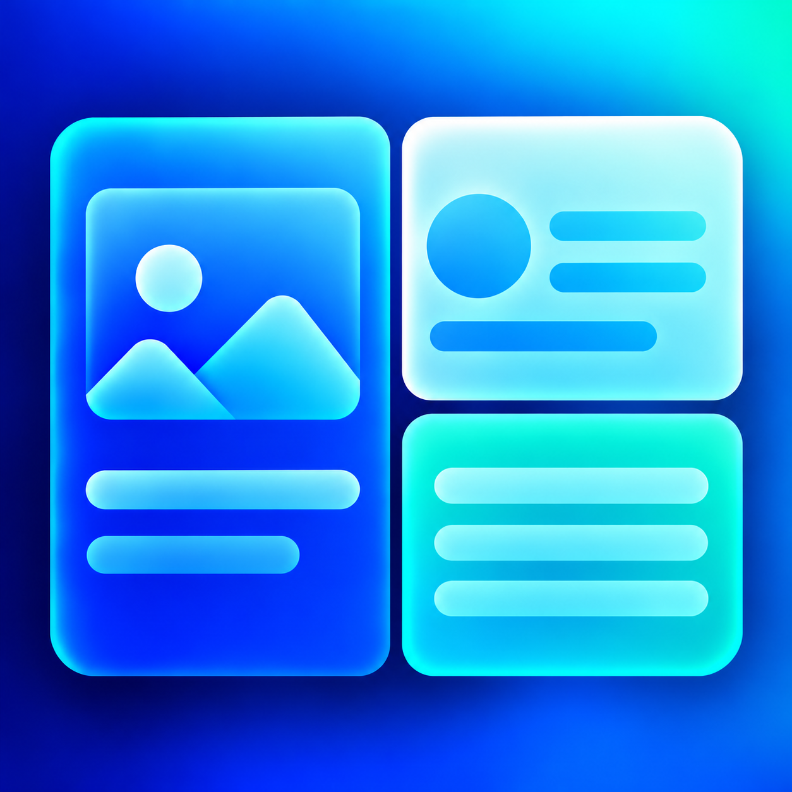
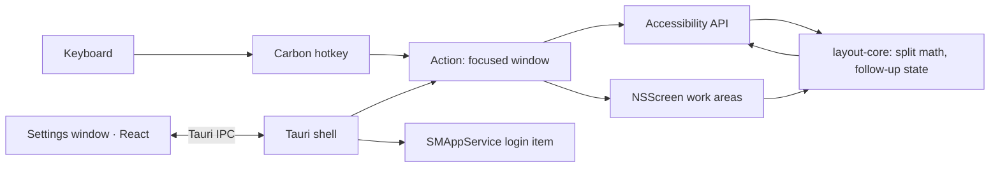

# IYAGI Layout

**Your Interface to AGI — snap windows in one keystroke**

> **IYAGI Layout** — Press a shortcut, get a half screen.

**English** | [한국어](README_KR.md) | [日本語](README_JA.md) | [中文](README_ZH.md)



## The brand

IYAGI is *iyagi* — 이야기, the Korean word for "story" — with **AGI** hiding in plain sight. One
name, one job: a workable interface between people and AGI. IYAGI Layout is a small sibling of
[IYAGI Terminal](https://github.com/sh2orc/iyagi-term): while you talk to AI agents in several terminals, it keeps the
windows around them in order.

```text
IYAGI
Your Interface to AGI

IYAGI Terminal     → AI Coding / Agentic Engineering
IYAGI Layout       → Window layout for the desktop      (this repository)
```

## IYAGI Layout

IYAGI Layout is a macOS menu-bar utility. Press **⌥⌘ + an arrow key** and the focused window of
**any app** snaps to the left, right, top or bottom **half** of its screen. Press a second arrow
within three seconds and it splits the window again — left, then down is the bottom-left quarter.

It lives in the menu bar, keeps running when you close its window, and starts at login. It is built
on Tauri 2 + Rust with the same signing and release flow as IYAGI Terminal. The window math is a
pure Rust crate; every macOS call sits behind a small, typed wrapper.

## Download

<p align="center">
  <a href="https://raw.githubusercontent.com/sh2orc/iyagi-layout/main/releases/IYAGI.Layout_0.1.0_aarch64.dmg">
    
  </a>
</p>


| Platform | File | Size | SHA-256 |
|---|---|---|---|
| macOS · Apple Silicon | [`IYAGI.Layout_0.1.0_aarch64.dmg`](https://raw.githubusercontent.com/sh2orc/iyagi-layout/main/releases/IYAGI.Layout_0.1.0_aarch64.dmg) | 9 MB | `a2998196ec2e2caefcadeca17e27b8493a05183d472a2bebdc6301925eaed341` |

<details>
<summary>Signing & trust on macOS</summary>

The build is signed with a Developer ID, notarized, and the ticket is stapled to both the app and
the DMG, so it opens without Gatekeeper warnings — `spctl` reports `source=Notarized Developer ID`.

The published SHA-256 travels in the same repository as the DMG, so it detects transport
corruption, not a compromise of the repository itself — see [releases/README.md](releases/README.md).
</details>

## Why IYAGI Layout

- **One keystroke, any app.** It moves other apps' windows through the macOS Accessibility API, so
  it works on Terminal, Chrome, VS Code, Finder — whatever is in front.
- **Quiet by design.** No Dock icon, no network access, no telemetry. The only permission it asks
  for is Accessibility. Global shortcuts use the Carbon hotkey API, so it never installs an event
  tap and cannot slow down your keyboard.
- **Honest about state.** The menu-bar status line tells you when permission is missing, the
  settings file is broken, or a shortcut could not be registered. Launch-at-login is read from the
  OS every time instead of being remembered by the app.
- **Fits the machine you have.** Tile math uses the screen's usable area (below the menu bar and
  notch, beside the Dock), re-read on every key press, so plugging a monitor in or out just works.

## Features

**Window snapping**

- `⌥⌘←` / `⌥⌘→` / `⌥⌘↑` / `⌥⌘↓` — left, right, top, bottom half of the screen the window is
  mostly on. Results are whole points and two halves never overlap or leave a gap
- **Follow-up split:** within `3 s` (adjustable, 0 turns it off) a perpendicular arrow divides the
  *current window* again — left then down = bottom-left quarter, then right = half of that.
  A parallel arrow (← then →) always goes back to screen halves
- Optional **cycle**: repeat the same key to rotate 1/2 → 2/3 → 1/3 (off by default)
- Optional **gap** (0–32 pt) between windows and at the screen edge
- Same-monitor only: a window stays on the screen it is on
- Safe with awkward windows: full-screen windows are left alone, fixed-size windows are only
  moved, Chromium/Electron apps get their `AXEnhancedUserInterface` handled so they do not animate,
  and unresponsive apps are cut off after 0.5 s instead of freezing the menu bar

**Background service**

- Menu-bar only (`LSUIElement`): no Dock icon, no app menu; closing the settings window hides it
  and the app keeps running. **Quit** is in the menu-bar menu and in the settings window
- Single instance: launching it again just opens the settings window
- **Launch at login** through `SMAppService` — it shows up under System Settings › General ›
  Login Items, survives moving the app, and its status (on / off / waiting for approval) is read
  back from macOS. A login-time launch stays quiet in the menu bar; a manual launch opens settings
- Menu-bar status line: Accessibility needed → settings-file error → shortcut registration failure
  → otherwise your current shortcuts

**Settings & appearance**

- Settings window with a live Accessibility card (it updates the moment you allow the app), a
  **shortcut recorder** that validates with the real parser, gap, follow-up window, cycle option,
  login-item toggle and a log-folder shortcut
- Plain JSON settings file, written atomically; a broken file is never overwritten, the app runs on
  defaults and says so
- Light and dark appearance follow the OS live
- **English, Korean, Japanese and Simplified Chinese**, chosen from the system language list
  (first supported language wins); every other language falls back to English

## Shortcuts

| Shortcut | Action |
|---|---|
| `⌥⌘←` / `⌥⌘→` | Left / right half |
| `⌥⌘↑` / `⌥⌘↓` | Top / bottom half |
| Perpendicular arrow within 3 s | Split the current window again (quarters) |
| Same key repeated (option) | 1/2 → 2/3 → 1/3 |

Any shortcut can be changed in Settings. If another app already owns a combination — Xcode and
some editors use `⌥⌘←/→` — IYAGI Layout reports it instead of failing silently.

## First run

1. Open the app. An icon appears in the menu bar and the settings window opens.
2. Allow **IYAGI Layout** under **System Settings › Privacy & Security › Accessibility**. The
   permission card turns green on its own.
3. Click any window and press `⌥⌘←`.
4. Turn on **Launch at Login** (menu bar or Settings). Install the app in `/Applications` first so
   the login item points at the installed copy.

To uninstall: turn off Launch at Login, quit, delete the app, and remove it from the Accessibility
list if you like.

## Architecture



```text
src/                  Settings window (React): shortcut recorder, permission card, i18n
src-tauri/            Tauri shell (menu-bar tray, hotkey wiring, settings file, logging, lifecycle)
crates/
  layout-core/        Pure logic: geometry, follow-up/cycle state, settings model, i18n messages
  layout-macos/       macOS wrappers: Accessibility, NSScreen, Carbon hotkeys, SMAppService, locale
  layout-probe/       Developer CLI that drives the macOS path without the Tauri shell
scripts/              Local signing runner, icon generation, Icon Composer asset build
```

Dependency direction is `shell → layout-macos → layout-core`. `layout-core` knows nothing about
macOS, Tauri or React, so its tests run on any OS. Every `unsafe` FFI call stays inside
`layout-macos`.

**Tech stack:** React 18 · TypeScript 5.9 · Vite 5 · Vitest 2 · Tauri 2.12 · Rust 2021
(objc2 bindings for AppKit, ApplicationServices and ServiceManagement; Carbon via FFI).

## Requirements

- macOS 13 (Ventura) or later; developed and verified on macOS 26 (Apple Silicon)
- Rust ≥ 1.89 (MSRV), Node 22 LTS, Xcode command-line tools (Xcode 26 for the macOS 26 icon)
- npm and Cargo lockfiles are committed; CI uses `npm ci` and `cargo --locked`

## Development

```sh
git clone https://github.com/sh2orc/iyagi-layout.git && cd iyagi-layout
npm ci
npm run typecheck && npm run test:unit      # TypeScript + vitest
cargo fmt --all --check
cargo clippy --workspace --all-targets --locked -- -D warnings
cargo test --workspace --locked
npm run tauri dev                           # run with local signing, inside "IYAGI Layout.app"
npm run tauri build                         # signed .app + DMG in target/release/bundle
```

Try the macOS path without the shell:

```sh
cargo run -p layout-probe -- permission     # Accessibility state
cargo run -p layout-probe -- screens        # screens in CoreGraphics coordinates
cargo run -p layout-probe -- focused        # frame of the focused window
cargo run -p layout-probe -- left --gap 8   # snap it
```

Diagnostics on the bundled executable: `iyagi-layout-app --login-item status|on|off`,
`--permission`, `--lang`. Set `IYAGI_LANG=ko|en|ja|zh` to force a UI language.

**Signing.** Accessibility permission is tied to the code signature. On macOS, `npm run tauri
dev|build` signs with a keychain identity named `iyagi-dev` when it exists (`scripts/tauri.mjs`; set
`IYAGI_SIGNING_IDENTITY` for another, `-` for ad-hoc) and prefers a single Developer ID Application
certificate for `build`. With ad-hoc signatures macOS treats every rebuild as a new app and asks again.
Note that a `tauri dev` app started from a terminal inherits the terminal's Accessibility trust.

**Icons.** The artwork lives in `src-tauri/icons/source/layout.png`. `python3 scripts/generate_icons.py`
builds the PNG/ICNS set and `scripts/build-icon-assets.sh` compiles the Icon Composer asset
(`AppIcon.icon`) into `Assets.car`, which macOS 26 needs to draw the icon edge to edge.

## Documentation

| Document | Content |
|---|---|
| [IMPLEMENTATION_PLAN.md](IMPLEMENTATION_PLAN.md) (Korean) | Decisions, macOS mechanisms and findings, behavior spec, tickets, risks |
| [releases/README.md](releases/README.md) | Release binaries, signing and notarization steps |

## Status & Roadmap

v0.1.0 — **MVP working.** Four-direction snapping, follow-up split, settings window, launch at
login and four languages run on macOS 26; the notarized build installs from `/Applications` or the DMG.

- **Next:** QA across more apps and monitor layouts, a GitHub-hosted release download
- **Later:** maximize / restore / center, quarter shortcuts, move to the adjacent monitor,
  optional edge-drag snapping

## License

Apache-2.0. See [LICENSE.md](LICENSE.md).
