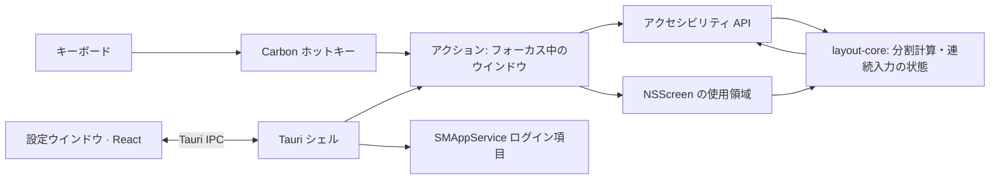

# IYAGI Layout

**Your Interface to AGI — キー1つでウインドウを整える**

> **IYAGI Layout** — ショートカット1つで画面の半分。

[English](README.md) | [한국어](README_KR.md) | **日本語** | [中文](README_ZH.md)


## ブランド

IYAGI は韓国語の **이야기**(*iyagi*、「物語」)と読み、その中に **AGI** が隠れています。ひとつの名前、
ひとつの役割 — 人と AGI のあいだに使えるインターフェースを置くこと。IYAGI Layout は
[IYAGI Terminal](https://github.com/sh2orc/iyagi-term) の小さな兄弟です。複数のターミナルで AI エージェントと話しているあいだ、
その周りのウインドウをきちんと整えます。

```text
IYAGI
Your Interface to AGI

IYAGI Terminal     → AI コーディング / エージェントエンジニアリング
IYAGI Layout       → デスクトップのウインドウ配置                    (このリポジトリ)
```

## IYAGI Layout

IYAGI Layout は macOS のメニューバー常駐ユーティリティです。**⌥⌘ + 矢印キー**を押すと、**どのアプリでも**
フォーカス中のウインドウがその画面の左・右・上・下の**半分**に合わさります。3 秒以内に別の矢印キーを
もう一度押すと、ウインドウをさらに分割します — 左の次に下を押すと左下の 1/4 です。

メニューバーに常駐し、設定ウインドウを閉じても動き続け、ログイン時に自動で起動します。IYAGI
Terminal と同じ署名・リリースの流れを使う Tauri 2 + Rust アプリで、ウインドウの計算は純粋な Rust
クレート、macOS の呼び出しはすべて小さな型付きラッパーの内側にあります。

## ダウンロード

<p align="center">
  <a href="https://raw.githubusercontent.com/sh2orc/iyagi-layout/main/releases/IYAGI.Layout_0.1.0_aarch64.dmg">
    
  </a>
</p>


| プラットフォーム | ファイル | サイズ | SHA-256 |
|---|---|---|---|
| macOS · Apple Silicon | [`IYAGI.Layout_0.1.0_aarch64.dmg`](https://raw.githubusercontent.com/sh2orc/iyagi-layout/main/releases/IYAGI.Layout_0.1.0_aarch64.dmg) | 9 MB | `a2998196ec2e2caefcadeca17e27b8493a05183d472a2bebdc6301925eaed341` |

<details>
<summary>macOS の署名と信頼性</summary>

ビルドは Developer ID で署名・公証され、チケットはアプリと DMG の両方にステープルされているため、
Gatekeeper の警告なしで開けます — `spctl` は `source=Notarized Developer ID` と判定します。

公開している SHA-256 は DMG と同じリポジトリにあるため、転送中の破損は検出できますが、リポジトリ
自体が侵害された場合は検出できません — [releases/README.md](releases/README.md) を参照してください。
</details>

## なぜ IYAGI Layout か

- **キー1つで、どのアプリでも。** macOS のアクセシビリティ API で他のアプリのウインドウを動かすため、
  ターミナル、Chrome、VS Code、Finder など、前面にあるものなら何でも動きます。
- **静かな設計。** Dock アイコンなし、ネットワークアクセスなし、テレメトリなし。求める権限は
  アクセシビリティだけです。グローバルショートカットは Carbon ホットキー API を使い、イベントタップを
  インストールしないので、キーボードを遅くしません。
- **状態を隠しません。** 権限がない、設定ファイルが壊れている、ショートカットを登録できない — そうした
  ときはメニューバーのステータス行が知らせます。ログイン時起動の状態はアプリが覚えず、毎回 OS から
  読み取ります。
- **今あるマシンに合わせます。** 計算には画面の使用可能領域(メニューバーとノッチの下、Dock の横)を
  キーを押すたびに読み直して使うので、モニターを抜き差ししてもそのまま動きます。

## 機能

**ウインドウの配置**

- `⌥⌘←` / `⌥⌘→` / `⌥⌘↑` / `⌥⌘↓` — ウインドウが最も多くかかっている画面の左・右・上・下の半分。
  結果は整数 pt で、2 つの半分が重なったり隙間ができたりしません
- **連続分割:** `3 秒`以内(変更可、0 でオフ)に軸の違う矢印キーを押すと、*現在のウインドウ*をさらに分割
  します — 左→下 = 左下 1/4、続けて右 = その半分。同じ軸(← の次に →)は常に画面の半分に戻ります
- 任意の**サイクル**: 同じキーを繰り返すと 1/2 → 2/3 → 1/3(初期状態ではオフ)
- 任意の**余白**(0–32 pt): ウインドウ間と画面の端
- 同じモニター内のみ: ウインドウは今いる画面にとどまります
- 扱いにくいウインドウにも安全: フルスクリーンは触らず、サイズ固定のウインドウは位置だけ動かし、
  Chromium/Electron アプリは `AXEnhancedUserInterface` を処理してアニメーションさせず、応答しない
  アプリは 0.5 秒で切り離してメニューバーが固まらないようにします

**バックグラウンドサービス**

- メニューバー専用(`LSUIElement`): Dock アイコンもアプリメニューもありません。設定ウインドウを閉じても
  隠れるだけでアプリは動き続けます。**終了**はメニューバーのメニューと設定ウインドウにあります
- 単一インスタンス: もう一度起動すると設定ウインドウが開くだけです
- **ログイン時に起動**は `SMAppService` で登録します — システム設定 › 一般 › ログイン項目に表示され、
  アプリを移動しても有効で、状態(オン / オフ / 承認待ち)は macOS から読み戻します。ログイン直後の
  自動起動は静かにメニューバーにとどまり、手動で起動すると設定ウインドウが開きます
- メニューバーのステータス行: アクセシビリティが必要 → 設定ファイルのエラー → ショートカット登録失敗
  → それ以外は現在のショートカット

**設定と外観**

- 設定ウインドウ: リアルタイムのアクセシビリティカード(許可した瞬間に更新)、実際のパーサーで検証する
  **ショートカット録画**、余白、連続入力の時間、サイクル設定、ログイン項目のトグル、ログフォルダへの
  ショートカット
- プレーンな JSON 設定ファイルをアトミックに保存します。壊れたファイルは上書きせず、初期値で動作して
  その旨を表示します
- ライト/ダークの外観は OS にリアルタイムで追従します
- **英語・韓国語・日本語・簡体字中国語**をシステムの言語リストから選びます(対応する最初の言語を採用)。
  それ以外の言語は英語で表示します

## ショートカット

| ショートカット | 動作 |
|---|---|
| `⌥⌘←` / `⌥⌘→` | 左 / 右の半分 |
| `⌥⌘↑` / `⌥⌘↓` | 上 / 下の半分 |
| 3 秒以内に軸の違う矢印 | 現在のウインドウをさらに分割(1/4) |
| 同じキーの繰り返し(オプション) | 1/2 → 2/3 → 1/3 |

すべてのショートカットは設定で変更できます。他のアプリがすでに使っている組み合わせ — Xcode や一部の
エディタは `⌥⌘←/→` を使います — は、黙って失敗せずに知らせます。

## 初回起動

1. アプリを開きます。メニューバーにアイコンが現れ、設定ウインドウが開きます。
2. **システム設定 › プライバシーとセキュリティ › アクセシビリティ**で **IYAGI Layout** を許可します。
   権限カードは自動的に緑色になります。
3. 任意のウインドウをクリックして `⌥⌘←` を押します。
4. **ログイン時に起動**をオンにします(メニューバーまたは設定)。ログイン項目がインストール済みのアプリを
   指すよう、先に `/Applications` へインストールしてください。

削除するには、ログイン時に起動をオフにして終了し、アプリを削除します。必要ならアクセシビリティの
リストからも外します。

## アーキテクチャ



```text
src/                  設定ウインドウ(React): ショートカット録画、権限カード、i18n
src-tauri/            Tauri シェル(メニューバートレイ、ホットキー接続、設定ファイル、ログ、ライフサイクル)
crates/
  layout-core/        純粋なロジック: ジオメトリ、連続入力/サイクルの状態、設定モデル、i18n メッセージ
  layout-macos/       macOS ラッパー: アクセシビリティ、NSScreen、Carbon ホットキー、SMAppService、ロケール
  layout-probe/       Tauri シェルなしで macOS 側を動かす開発用 CLI
scripts/              ローカル署名 runner、アイコン生成、Icon Composer アセットのビルド
```

依存の向きは `シェル → layout-macos → layout-core` です。`layout-core` は macOS・Tauri・React を一切
知らないので、テストはどの OS でも動きます。すべての `unsafe` FFI 呼び出しは `layout-macos` の中にあります。

**技術スタック:** React 18 · TypeScript 5.9 · Vite 5 · Vitest 2 · Tauri 2.12 · Rust 2021
(AppKit・ApplicationServices・ServiceManagement は objc2 バインディング、Carbon は FFI)。

## 動作要件

- macOS 13(Ventura)以降。macOS 26(Apple Silicon)で開発・検証
- Rust ≥ 1.89(MSRV)、Node 22 LTS、Xcode コマンドラインツール(macOS 26 のアイコンには Xcode 26)
- npm と Cargo の lockfile をコミットしており、CI は `npm ci` と `cargo --locked` を使います

## 開発

```sh
git clone https://github.com/sh2orc/iyagi-layout.git && cd iyagi-layout
npm ci
npm run typecheck && npm run test:unit      # TypeScript + vitest
cargo fmt --all --check
cargo clippy --workspace --all-targets --locked -- -D warnings
cargo test --workspace --locked
npm run tauri dev                           # ローカル署名で「IYAGI Layout.app」内から実行
npm run tauri build                         # target/release/bundle に署名済み .app と DMG
```

シェルなしで macOS 側だけ確認:

```sh
cargo run -p layout-probe -- permission     # アクセシビリティの状態
cargo run -p layout-probe -- screens        # CoreGraphics 座標の画面一覧
cargo run -p layout-probe -- focused        # フォーカス中のウインドウのフレーム
cargo run -p layout-probe -- left --gap 8   # 配置してみる
```

バンドル内の実行ファイルの診断: `iyagi-layout-app --login-item status|on|off`、`--permission`、`--lang`。
`IYAGI_LANG=ko|en|ja|zh` で UI 言語を強制できます。

**署名。** アクセシビリティの許可はコード署名に結び付いています。macOS では `npm run tauri dev|build` が、
キーチェーンに `iyagi-dev` があればそれで署名し(`scripts/tauri.mjs`、別の名前は `IYAGI_SIGNING_IDENTITY`、
ad-hoc は `-`)、`build` は Developer ID Application 証明書が 1 つだけならそれを優先します。ad-hoc 署名だと
再ビルドのたびに新しいアプリとみなされ、もう一度許可を求められます。ターミナルから起動した
`tauri dev` のアプリは、そのターミナルのアクセシビリティ信頼を引き継ぐ点にも注意してください。

**アイコン。** 元画像は `src-tauri/icons/source/layout.png` です。`python3 scripts/generate_icons.py` が
PNG/ICNS 一式を作り、`scripts/build-icon-assets.sh` が Icon Composer アセット(`AppIcon.icon`)を
`Assets.car` にコンパイルします。macOS 26 がアイコンを端まで描くにはこのファイルが必要です。

## ドキュメント

| ドキュメント | 内容 |
|---|---|
| [IMPLEMENTATION_PLAN.md](IMPLEMENTATION_PLAN.md)(韓国語) | 決定事項、macOS の仕組みと検証結果、動作仕様、チケット、リスク |
| [releases/README.md](releases/README.md) | リリースバイナリ、署名と公証の手順 |

## ステータスとロードマップ

v0.1.0 — **MVP 動作中。** 4 方向の配置、連続分割、設定ウインドウ、ログイン時起動、4 言語が macOS 26 で
動作し、公証済みのビルドを DMG から `/Applications` にインストールして使えます。

- **次:** より多くのアプリ・モニター構成での QA、GitHub 上のリリースダウンロード
- **その後:** 最大化 / 元に戻す / 中央、1/4 のショートカット、隣のモニターへ移動、任意のエッジドラッグスナップ

## ライセンス

Apache-2.0。[LICENSE.md](LICENSE.md) を参照してください。
