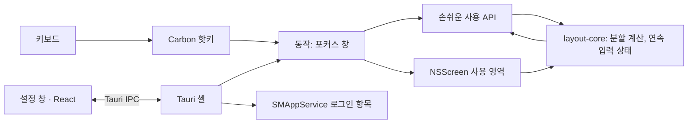

# IYAGI Layout

**Your Interface to AGI — 키 한 번으로 창 정리**

> **IYAGI Layout** — 단축키 하나로 화면 절반.

[English](README.md) | **한국어** | [日本語](README_JA.md) | [中文](README_ZH.md)


## 브랜드

IYAGI는 한국어 **이야기**로 읽히고, 그 안에 **AGI**가 숨어 있습니다. 하나의 이름, 하나의 역할 —
사람과 AGI 사이에 쓸 만한 인터페이스를 놓는 것. IYAGI Layout은 [IYAGI Terminal](https://github.com/sh2orc/iyagi-term)의
작은 형제입니다. 여러 터미널에서 AI 에이전트와 이야기하는 동안, 그 주변의 창을 가지런히 둡니다.

```text
IYAGI
Your Interface to AGI

IYAGI Terminal     → AI 코딩 / 에이전트 엔지니어링
IYAGI Layout       → 데스크톱 창 배치                 (이 저장소)
```

## IYAGI Layout

IYAGI Layout은 macOS 메뉴 막대 유틸리티입니다. **⌥⌘ + 방향키**를 누르면 **어느 앱이든** 포커스된
창이 그 화면의 왼쪽·오른쪽·위·아래 **절반**에 맞춰집니다. 3초 안에 다른 방향키를 한 번 더 누르면
창을 다시 나눕니다 — 왼쪽 다음 아래는 왼쪽 아래 1/4입니다.

메뉴 막대에 상주하고, 설정 창을 닫아도 계속 실행되며, 로그인하면 자동으로 시작합니다. IYAGI
Terminal과 같은 서명·릴리스 흐름의 Tauri 2 + Rust 앱입니다. 창 계산은 순수 Rust crate이고, macOS
호출은 모두 작고 타입이 있는 래퍼 뒤에 있습니다.

<p align="center">
  <a href="docs/media/iyagi-layout-intro.mp4">
    
  </a>
  <br>
  <sub>30초 소개 영상(영어) · <a href="docs/media/iyagi-layout-intro.mp4">MP4, 1080p</a></sub>
</p>

## 다운로드

<p align="center">
  <a href="https://github.com/sh2orc/iyagi-layout/releases/download/v0.1.1/IYAGI.Layout_0.1.1_aarch64.dmg">
    
  </a>
</p>


| 플랫폼 | 파일 | 크기 | SHA-256 |
|---|---|---|---|
| macOS · Apple Silicon | [`IYAGI.Layout_0.1.1_aarch64.dmg`](https://github.com/sh2orc/iyagi-layout/releases/download/v0.1.1/IYAGI.Layout_0.1.1_aarch64.dmg) | 9 MB | `2fe34193a8525e20b82231af913726b19c030a6e16cdbd5c691890d9126deade` |

<details>
<summary>macOS 서명과 신뢰</summary>

빌드는 Developer ID로 서명하고 공증했으며 티켓을 앱과 DMG 모두에 스테이플해 Gatekeeper 경고 없이
열립니다 — `spctl`은 `source=Notarized Developer ID`로 판정합니다.

게시된 SHA-256(GitHub 릴리스 노트)은 전송 중 손상을 감지하지만 릴리스 자체가 침해된 경우는
검증하지 못합니다. 스테이플된 공증 티켓은 GitHub과 무관하게 macOS가 직접 확인합니다 — [releases/README.md](releases/README.md)를 참고하세요.
</details>

## 왜 IYAGI Layout인가

- **키 하나, 모든 앱.** macOS 손쉬운 사용 API로 다른 앱의 창을 옮기므로 터미널, Chrome, VS Code,
  Finder 등 앞에 있는 어떤 앱이든 동작합니다.
- **조용한 설계.** Dock 아이콘 없음, 네트워크 접근 없음, 원격 측정 없음. 요구하는 권한은 손쉬운 사용
  하나뿐입니다. 전역 단축키는 Carbon 핫키 API를 써서 이벤트 탭을 설치하지 않으므로 키보드를
  느리게 만들지 않습니다.
- **상태를 숨기지 않습니다.** 권한이 없거나, 설정 파일이 깨졌거나, 단축키를 등록하지 못하면 메뉴
  막대 상태 줄이 알려 줍니다. 단축키로 창을 옮길 수 없으면(전체 화면 창, 포커스된 창 없음, IYAGI Layout 자신의 창)
  메뉴 막대 아이콘 옆에 3초 동안 경고가 뜨고, 상태 줄에는 마지막 실패가 남습니다. 로그인 시 실행 여부는 앱이 기억하지 않고 매번 OS에서 읽습니다.
- **지금 쓰는 기기에 맞춥니다.** 계산은 화면의 사용 가능 영역(메뉴 막대·노치 아래, Dock 옆)을 키를
  누를 때마다 다시 읽어 쓰므로 모니터를 꽂고 빼도 그대로 동작합니다.

## 기능

**창 배치**

- `⌥⌘←` / `⌥⌘→` / `⌥⌘↑` / `⌥⌘↓` — 창이 가장 많이 걸친 화면의 왼쪽·오른쪽·위·아래 절반. 결과는
  정수 pt이고 두 절반은 겹치거나 틈이 생기지 않습니다
- **연속 분할:** `3초`(조절 가능, 0이면 끔) 안에 축이 다른 방향키를 누르면 *현재 창*을 다시 나눕니다 —
  왼쪽 다음 아래 = 왼쪽 아래 1/4, 이어서 오른쪽 = 그 1/4의 절반. 같은 축(← 다음 →)은 항상 화면
  절반으로 돌아갑니다
- 선택 사항 **순환**: 같은 키를 반복하면 1/2 → 2/3 → 1/3 (기본 꺼짐)
- 선택 사항 **간격**(0–32 pt): 창 사이와 화면 가장자리
- 같은 모니터 안에서만: 창은 지금 있는 화면에 머뭅니다
- 까다로운 창에도 안전: 전체 화면 창은 건드리지 않고, 크기 고정 창은 위치만 옮기며,
  Chromium/Electron 앱은 `AXEnhancedUserInterface`를 처리해 애니메이션 없이 옮기고, 응답 없는
  앱은 0.5초 뒤에 끊어 메뉴 막대가 멈추지 않게 합니다

**백그라운드 서비스**

- 메뉴 막대 전용(`LSUIElement`): Dock 아이콘·앱 메뉴 없음. 설정 창을 닫거나 **메뉴 막대로 숨기기** 버튼을 누르면
  창만 숨고 앱은 계속 실행됩니다. **종료**는 메뉴 막대 메뉴에 있습니다
- 단일 인스턴스: 다시 실행하면 설정 창만 엽니다
- **로그인 시 실행**은 `SMAppService`로 등록합니다 — 시스템 설정 › 일반 › 로그인 항목에 나타나고, 앱을
  옮겨도 유지되며, 상태(켜짐 / 꺼짐 / 승인 대기)를 macOS에서 다시 읽습니다. 로그인 직후 자동 실행은
  조용히 메뉴 막대에만 머물고, 직접 실행하면 설정 창을 엽니다
- 메뉴 막대 상태 줄: 손쉬운 사용 필요 → 설정 파일 오류 → 단축키 등록 실패 → 마지막 실패한 동작 → 그 외에는 현재 단축키

**설정과 화면**

- 설정 창: 실시간 손쉬운 사용 카드(허용하는 순간 갱신), 실제 파서로 검증하는 **단축키 녹화기**, 간격,
  연속 입력 시간, 순환 옵션, 로그인 항목 토글, 로그 폴더 바로가기
- 평문 JSON 설정 파일을 원자적으로 저장합니다. 깨진 파일은 덮어쓰지 않고 기본값으로 동작하며 그
  사실을 알립니다
- 라이트·다크 화면이 OS를 실시간으로 따릅니다
- **영어·한국어·일본어·중국어 간체**를 시스템 언어 목록에서 고릅니다(지원하는 첫 언어 우선). 그 외
  언어는 영어로 표시합니다

## 단축키

| 단축키 | 동작 |
|---|---|
| `⌥⌘←` / `⌥⌘→` | 왼쪽 / 오른쪽 절반 |
| `⌥⌘↑` / `⌥⌘↓` | 위 / 아래 절반 |
| 3초 안에 축이 다른 방향키 | 현재 창을 다시 나눔(1/4) |
| 같은 키 반복(옵션) | 1/2 → 2/3 → 1/3 |

모든 단축키는 설정에서 바꿀 수 있습니다. 다른 앱이 이미 쓰는 조합이면 — Xcode와 일부 에디터는
`⌥⌘←/→`를 씁니다 — 조용히 실패하지 않고 그 사실을 알려 줍니다.

## 처음 실행

1. 앱을 엽니다. 메뉴 막대에 아이콘이 생기고 설정 창이 열립니다.
2. **시스템 설정 › 개인정보 보호 및 보안 › 손쉬운 사용**에서 **IYAGI Layout**을 허용합니다. 권한
   카드가 저절로 초록색으로 바뀝니다.
3. 아무 창이나 클릭하고 `⌥⌘←`를 누릅니다.
4. **로그인 시 실행**을 켭니다(메뉴 막대 또는 설정). 로그인 항목이 설치된 앱을 가리키도록 먼저
   `/Applications`에 설치하세요.

제거하려면 로그인 시 실행을 끄고, 종료한 뒤, 앱을 삭제합니다. 원하면 손쉬운 사용 목록에서도
지웁니다.

## 아키텍처



```text
src/                  설정 창(React): 단축키 녹화기, 권한 카드, i18n
src-tauri/            Tauri 셸(메뉴 막대 트레이, 핫키 연결, 설정 파일, 로그, 생명주기)
crates/
  layout-core/        순수 로직: 기하, 연속 입력/순환 상태, 설정 모델, i18n 문구
  layout-macos/       macOS 래퍼: 손쉬운 사용, NSScreen, Carbon 핫키, SMAppService, 로케일
  layout-probe/       Tauri 셸 없이 macOS 경로를 돌려 보는 개발용 CLI
scripts/              로컬 서명 runner, 아이콘 생성, Icon Composer 에셋 빌드
```

의존 방향은 `셸 → layout-macos → layout-core`입니다. `layout-core`는 macOS·Tauri·React를 전혀
모르므로 테스트가 어느 OS에서든 돕니다. 모든 `unsafe` FFI 호출은 `layout-macos` 안에 있습니다.

**기술 스택:** React 18 · TypeScript 5.9 · Vite 5 · Vitest 2 · Tauri 2.12 · Rust 2021
(AppKit·ApplicationServices·ServiceManagement는 objc2 바인딩, Carbon은 FFI).

## 요구 사항

- macOS 13(Ventura) 이상. macOS 26(Apple Silicon)에서 개발·검증
- Rust ≥ 1.89(MSRV), Node 22 LTS, Xcode 명령줄 도구(macOS 26 아이콘은 Xcode 26)
- npm·Cargo lockfile을 커밋하며 CI는 `npm ci`와 `cargo --locked`를 씁니다

## 개발

```sh
git clone https://github.com/sh2orc/iyagi-layout.git && cd iyagi-layout
npm ci
npm run typecheck && npm run test:unit      # TypeScript + vitest
cargo fmt --all --check
cargo clippy --workspace --all-targets --locked -- -D warnings
cargo test --workspace --locked
npm run tauri dev                           # 로컬 서명으로 "IYAGI Layout.app" 안에서 실행
npm run tauri build                         # target/release/bundle에 서명된 .app + DMG
```

셸 없이 macOS 경로만 확인:

```sh
cargo run -p layout-probe -- permission     # 손쉬운 사용 상태
cargo run -p layout-probe -- screens        # CoreGraphics 좌표의 화면 목록
cargo run -p layout-probe -- focused        # 포커스 창의 프레임
cargo run -p layout-probe -- left --gap 8   # 배치해 보기
```

번들 실행 파일 진단: `iyagi-layout-app --login-item status|on|off`, `--permission`, `--lang`.
`IYAGI_LANG=ko|en|ja|zh`로 UI 언어를 강제할 수 있습니다.

**서명.** 손쉬운 사용 권한은 코드 서명에 묶입니다. macOS에서 `npm run tauri dev|build`는 키체인에
`iyagi-dev` 인증서가 있으면 그것으로 서명하고(`scripts/tauri.mjs`, 다른 이름은 `IYAGI_SIGNING_IDENTITY`,
ad-hoc은 `-`), `build`는 Developer ID Application 인증서가 하나면 우선 사용합니다. ad-hoc 서명이면
재빌드마다 새 앱으로 보고 다시 묻습니다. 터미널에서 띄운 `tauri dev` 앱은 그 터미널의 손쉬운 사용
신뢰를 물려받는다는 점도 알아 두세요.

**아이콘.** 원본은 `src-tauri/icons/source/layout.png`입니다. `python3 scripts/generate_icons.py`가
PNG/ICNS 세트를 만들고 `scripts/build-icon-assets.sh`가 Icon Composer 에셋(`AppIcon.icon`)을
`Assets.car`로 컴파일합니다. macOS 26이 아이콘을 가장자리까지 채워 그리려면 이 파일이 필요합니다.

## 문서

| 문서 | 내용 |
|---|---|
| [IMPLEMENTATION_PLAN.md](IMPLEMENTATION_PLAN.md) | 결정 사항, macOS 메커니즘과 검증 결과, 동작 명세, 티켓, 위험 |
| [releases/README.md](releases/README.md) | 릴리스 바이너리, 서명·공증 절차 |
| [docs/media/intro/](docs/media/intro/) | 30초 소개 영상 소스(`intro.html` + `render.mjs`, 다시 만들기: `node docs/media/intro/render.mjs`) |

## 상태와 로드맵

v0.1.1 — **앱 전환 직후 재시도.** 앱을 막 바꾼 직후 누른 단축키는 macOS가 포커스를 정할 때까지 최대 1.5초
기다리고, 창을 옮길 수 없으면 메뉴 막대에 경고를 띄웁니다. DMG는 [v0.1.1 릴리스](https://github.com/sh2orc/iyagi-layout/releases/tag/v0.1.1)에서 받을 수 있습니다.

v0.1.0 — **MVP 동작.** 4방향 배치, 연속 분할, 설정 창, 로그인 시 실행, 4개 언어가 macOS 26에서
동작하고, 공증을 마친 빌드를 DMG로 `/Applications`에 설치해 쓸 수 있습니다.

- **다음:** 더 많은 앱·모니터 구성에서 QA
- **이후:** 최대화 / 복원 / 중앙, 1/4 단축키, 옆 모니터로 이동, 선택형 가장자리 드래그 스냅

## 라이선스

Apache-2.0. [LICENSE.md](LICENSE.md)를 참고하세요.
