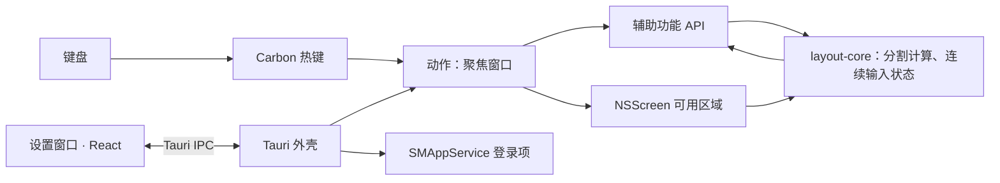

# IYAGI Layout

**Your Interface to AGI — 一个按键整理窗口**

> **IYAGI Layout** — 一个快捷键，占满半个屏幕。

[English](README.md) | [한국어](README_KR.md) | [日本語](README_JA.md) | **中文**


## 品牌

IYAGI 读作韩语的 **이야기**(*iyagi*，意为"故事")，**AGI** 就藏在其中。一个名字，一项使命 —— 在人与 AGI
之间搭起一个好用的界面。IYAGI Layout 是 [IYAGI Terminal](https://github.com/sh2orc/iyagi-term) 的小兄弟：当你在多个终端里与 AI
智能体对话时，它负责把周围的窗口整理好。

```text
IYAGI
Your Interface to AGI

IYAGI Terminal     → AI 编程 / 智能体工程   
IYAGI Layout       → 桌面窗口布局              (本仓库)
```

## IYAGI Layout

IYAGI Layout 是一个 macOS 菜单栏常驻工具。按下 **⌥⌘ + 方向键**，**任何应用**中当前聚焦的窗口都会贴合到
所在屏幕的左、右、上、下**一半**。3 秒内再按一个方向键，窗口会被再次分割 —— 先左后下就是左下四分之一。

它常驻菜单栏，关闭设置窗口后继续运行，并在登录时自动启动。它是一个 Tauri 2 + Rust 应用，签名与发布流程
与 IYAGI Terminal 相同；窗口计算是纯 Rust crate，所有 macOS 调用都封装在小巧的类型化包装层之后。

<p align="center">
  <a href="docs/media/iyagi-layout-intro.mp4">
    
  </a>
  <br>
  <sub>30 秒介绍视频(英语) · <a href="docs/media/iyagi-layout-intro.mp4">MP4, 1080p</a></sub>
</p>

## 下载

<p align="center">
  <a href="https://github.com/sh2orc/iyagi-layout/releases/download/v0.1.6/IYAGI.Layout_0.1.6_aarch64.dmg">
    
  </a>
  <br>
  <a href="https://www.buymeacoffee.com/sh2orc">
    
  </a>
</p>


| 平台 | 文件 | 大小 | SHA-256 |
|---|---|---|---|
| macOS · Apple Silicon | [`IYAGI.Layout_0.1.6_aarch64.dmg`](https://github.com/sh2orc/iyagi-layout/releases/download/v0.1.6/IYAGI.Layout_0.1.6_aarch64.dmg) | 9 MB | `68f07fa144d94cf56c24215080ac6fe2a6a6e91210fcbfee591da986f88b6ac0` |

<details>
<summary>macOS 签名与信任</summary>

该构建使用 Developer ID 签名并已公证，公证票据已装订到应用和 DMG 上，因此打开时不会出现 Gatekeeper
警告 —— `spctl` 判定为 `source=Notarized Developer ID`。

公布的 SHA-256(见 GitHub 发布说明)只能发现传输过程中的损坏，无法发现发布本身被篡改的情况。已装订的公证票据由 macOS 独立验证，与 GitHub 无关 ——
参见 [releases/README.md](releases/README.md)。
</details>

## 为什么选择 IYAGI Layout

- **一个按键，任何应用。** 通过 macOS 辅助功能 API 移动其他应用的窗口，因此终端、Chrome、VS Code、
  Finder 等位于前台的应用都可以使用。
- **安静的设计。** 没有 Dock 图标，不联网，不收集遥测数据。它只请求辅助功能这一项权限。全局快捷键使用
  Carbon 热键 API，不会安装事件监听(event tap)，也就不会拖慢键盘。
- **如实呈现状态。** 缺少权限、设置文件损坏或快捷键无法注册时，菜单栏状态行都会告诉你。快捷键无法移动窗口时(全屏窗口、没有聚焦的窗口、IYAGI Layout 自己的窗口)，菜单栏图标旁会显示 3 秒警告，状态行保留最后一次失败。登录时启动的状态
  不由应用自己记忆，而是每次从系统读取。
- **适配你手上的设备。** 计算使用屏幕的可用区域(菜单栏和刘海之下、Dock 旁边)，每次按键都会重新读取，
  所以插拔显示器也能正常工作。

## 功能

**窗口贴合**

- `⌥⌘←` / `⌥⌘→` / `⌥⌘↑` / `⌥⌘↓` —— 窗口所占面积最大的那块屏幕的左、右、上、下一半。结果为整数 pt，
  两个半屏不会重叠，也不会留下缝隙
- **连续分割：** 在 `3 秒`内(可调，0 为关闭)按下不同轴的方向键，会再次分割*当前窗口* —— 先左后下 = 左下
  四分之一，再按右 = 其中的一半。同一轴(先 ← 后 →)总是回到屏幕半屏
- 可选的**循环**：重复按同一个键，在 1/2 → 2/3 → 1/3 之间切换(默认关闭)
- 可选的**间距**(0–32 pt)：窗口之间以及屏幕边缘
- 仅限同一显示器：窗口始终留在它所在的屏幕上
- 对特殊窗口也安全：全屏窗口不会被改动，固定大小的窗口只移动位置，Chromium/Electron 应用会处理
  `AXEnhancedUserInterface` 以避免动画，无响应的应用在 0.5 秒后被切断，不会卡住菜单栏

**后台服务**

- 仅菜单栏(`LSUIElement`)：没有 Dock 图标，也没有应用菜单。关闭设置窗口或点击**隐藏到菜单栏**按钮只是隐藏，应用继续运行。
  **退出**位于菜单栏菜单中
- 单实例：再次启动只会打开设置窗口
- **登录时启动**通过 `SMAppService` 注册 —— 显示在系统设置 › 通用 › 登录项中，移动应用后依然有效，状态
  (开启 / 关闭 / 等待批准)会从 macOS 读回。登录时的自动启动安静地停留在菜单栏，手动启动则打开设置窗口
- 菜单栏状态行：需要辅助功能 → 设置文件错误 → 快捷键注册失败 → 上次失败的操作 → 否则显示当前快捷键

**设置与外观**

- 设置窗口：实时的辅助功能卡片(允许的瞬间即更新)、用真实解析器校验的**快捷键录制器**、间距、连续输入
  时间、循环选项、登录项开关和日志文件夹入口
- 纯文本 JSON 设置文件，原子写入；损坏的文件不会被覆盖，应用以默认值运行并给出提示
- 浅色与深色外观实时跟随系统
- **英语、韩语、日语和简体中文**，依据系统语言列表选择(采用第一个受支持的语言)；其他语言一律显示英语

## 快捷键

| 快捷键 | 动作 |
|---|---|
| `⌥⌘←` / `⌥⌘→` | 左 / 右半屏 |
| `⌥⌘↑` / `⌥⌘↓` | 上 / 下半屏 |
| 3 秒内按不同轴的方向键 | 再次分割当前窗口(四分之一) |
| 重复同一个键(选项) | 1/2 → 2/3 → 1/3 |

所有快捷键都可以在设置中修改。如果某个组合已被其他应用占用 —— Xcode 和部分编辑器使用 `⌥⌘←/→` ——
IYAGI Layout 会明确告知，而不是悄悄失败。

## 首次运行

1. 打开应用。菜单栏出现图标，并弹出设置窗口。
2. 在**系统设置 › 隐私与安全性 › 辅助功能**中允许 **IYAGI Layout**。权限卡片会自动变绿。
3. 点击任意窗口，按下 `⌥⌘←`。
4. 开启**登录时启动**(菜单栏或设置中)。请先把应用安装到 `/Applications`，这样登录项才会指向已安装的副本。

卸载：关闭登录时启动，退出应用，然后删除应用。也可以顺便从辅助功能列表中移除。

## 架构



```text
src/                  设置窗口(React)：快捷键录制器、权限卡片、i18n
src-tauri/            Tauri 外壳(菜单栏托盘、热键接线、设置文件、日志、生命周期)
crates/
  layout-core/        纯逻辑：几何、连续输入/循环状态、设置模型、i18n 文案
  layout-macos/       macOS 包装层：辅助功能、NSScreen、Carbon 热键、SMAppService、区域设置
  layout-probe/       不依赖 Tauri 外壳、直接驱动 macOS 路径的开发用 CLI
scripts/              本地签名 runner、图标生成、Icon Composer 资源构建
```

依赖方向是 `外壳 → layout-macos → layout-core`。`layout-core` 完全不了解 macOS、Tauri 和 React，因此它的
测试可以在任何系统上运行。所有 `unsafe` FFI 调用都留在 `layout-macos` 内部。

**技术栈：** React 18 · TypeScript 5.9 · Vite 5 · Vitest 2 · Tauri 2.12 · Rust 2021
(AppKit、ApplicationServices、ServiceManagement 使用 objc2 绑定，Carbon 通过 FFI)。

## 系统要求

- macOS 13(Ventura)或更高版本；在 macOS 26(Apple Silicon)上开发与验证
- Rust ≥ 1.89(MSRV)、Node 22 LTS、Xcode 命令行工具(macOS 26 图标需要 Xcode 26)
- 已提交 npm 与 Cargo 的 lockfile，CI 使用 `npm ci` 和 `cargo --locked`

## 开发

```sh
git clone https://github.com/sh2orc/iyagi-layout.git && cd iyagi-layout
npm ci
npm run typecheck && npm run test:unit      # TypeScript + vitest
cargo fmt --all --check
cargo clippy --workspace --all-targets --locked -- -D warnings
cargo test --workspace --locked
npm run tauri dev                           # 使用本地签名，在"IYAGI Layout.app"内运行
npm run tauri build                         # 在 target/release/bundle 生成已签名的 .app 和 DMG
```

不借助外壳单独验证 macOS 路径：

```sh
cargo run -p layout-probe -- permission     # 辅助功能状态
cargo run -p layout-probe -- screens        # CoreGraphics 坐标下的屏幕列表
cargo run -p layout-probe -- focused        # 聚焦窗口的 frame
cargo run -p layout-probe -- left --gap 8   # 试着贴合
```

对打包后的可执行文件进行诊断：`iyagi-layout-app --login-item status|on|off`、`--permission`、`--lang`。
设置 `IYAGI_LANG=ko|en|ja|zh` 可强制指定界面语言。

**签名。** 辅助功能权限与代码签名绑定。在 macOS 上，`npm run tauri dev|build` 会在钥匙串中存在名为
`iyagi-dev` 的证书时使用它签名(`scripts/tauri.mjs`；其他名称用 `IYAGI_SIGNING_IDENTITY`，ad-hoc 用 `-`)，
`build` 在只有一张 Developer ID Application 证书时优先使用它。使用 ad-hoc 签名时，每次重新构建都会被视为
新应用并再次询问权限。另外请注意：从终端启动的 `tauri dev` 应用会继承该终端的辅助功能授权。

**图标。** 原图位于 `src-tauri/icons/source/layout.png`。`python3 scripts/generate_icons.py` 生成 PNG/ICNS
图标集，`scripts/build-icon-assets.sh` 把 Icon Composer 资源(`AppIcon.icon`)编译为 `Assets.car`。macOS 26
需要它才能让图标铺满边缘。

## 文档

| 文档 | 内容 |
|---|---|
| [IMPLEMENTATION_PLAN.md](IMPLEMENTATION_PLAN.md)(韩语) | 决策、macOS 机制与验证结果、行为规范、任务、风险 |
| [releases/README.md](releases/README.md) | 发布二进制文件、签名与公证步骤 |
| [docs/media/intro/](docs/media/intro/) | 30 秒介绍视频的源码(`intro.html` + `render.mjs`，重新渲染：`node docs/media/intro/render.mjs`) |

## 状态与路线图

v0.1.6 —— **更流畅的窗口贴合。** 贴合改为在后台线程执行，无响应的应用不会再卡住菜单栏;Chromium/Electron 窗口的动画判断加入缓存，速度更快。快捷键重复会在录制的瞬间提示，`CommandOrControl` 别名也无法绕过重复检查。日志保留 14 天后清理，隐藏的设置窗口停止轮询，日志级别和 Chromium 动画策略移入新的“高级”部分。DMG 在 [v0.1.6 发布页](https://github.com/sh2orc/iyagi-layout/releases/tag/v0.1.6)。

v0.1.5 —— **设置窗口高度适应内容。** 打开应用时底部按钮不再被截断。依赖已升级(React 19、Vite 8、TypeScript 7)，`npm audit` 无问题。内部锁被污染时改为恢复，不再 panic。DMG 在 [v0.1.5 发布页](https://github.com/sh2orc/iyagi-layout/releases/tag/v0.1.5)。

v0.1.4 —— **修复 macOS 14 崩溃。** macOS 14.0–14.3 没有 `NSScreen.CGDirectDisplayID`，按下快捷键时应用会中止。现在屏幕 ID 从 `NSScreenNumber` 读取，快捷键回调会捕获 panic 和 Objective-C 异常。DMG 可从 [v0.1.4 发布页](https://github.com/sh2orc/iyagi-layout/releases/tag/v0.1.4) 下载。

v0.1.3 —— **Chrome 焦点修复。** Chrome 位于最前时，快捷键也能移动窗口。Chrome 在某些状态下不会向 macOS 报告聚焦的应用，因此改为从最前面的应用查找窗口。DMG 可从 [v0.1.3 发布页](https://github.com/sh2orc/iyagi-layout/releases/tag/v0.1.3) 下载。

v0.1.2 —— **隐藏到菜单栏。** 设置窗口中的红色按钮现在只隐藏窗口，应用继续留在菜单栏；菜单栏图标改用应用图标。DMG 可从 [v0.1.2 发布页](https://github.com/sh2orc/iyagi-layout/releases/tag/v0.1.2) 下载。

v0.1.1 —— **切换应用后重试。** 切换应用后立即按下的快捷键会等待最长 1.5 秒，直到 macOS 确定焦点；无法移动窗口时，菜单栏会显示警告。DMG 可从 [v0.1.1 发布页](https://github.com/sh2orc/iyagi-layout/releases/tag/v0.1.1) 下载。

v0.1.0 —— **MVP 已可用。** 四方向贴合、连续分割、设置窗口、登录时启动和四种语言已在 macOS 26 上运行，
已公证的构建可通过 DMG 安装到 `/Applications` 使用。

- **下一步：** 在更多应用和显示器组合下做 QA
- **之后：** 最大化 / 还原 / 居中、四分之一快捷键、移动到相邻显示器、可选的拖到边缘贴合

## 许可证

Apache-2.0。参见 [LICENSE.md](LICENSE.md)。
